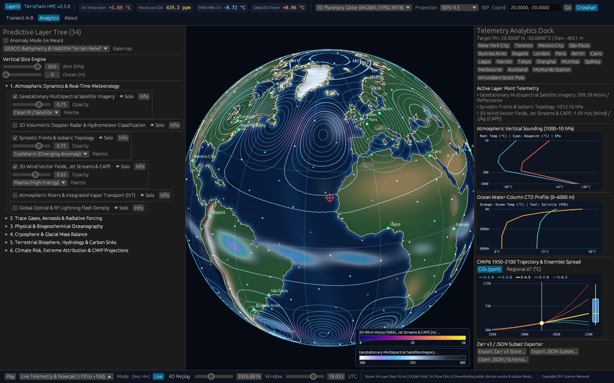

# TerraTwin HPC Climate Modeling & Telemetry Hub (`v2.5.0`)



A native Rust **headless background daemon + desktop global map GUI** (`terratwin`, `#![forbid(unsafe_code)]` library core and `#![deny(unsafe_code)]` CLI binary) paired with a standalone **HTML5 interactive browser workstation** (`web/terratwin_live_preview.html`), implementing the complete `climate_modeling_hub_schema.json` specification across **6 layer groups and 34 predictive layers** from `1950` to `2100`.

* **User Guide:** [docs/USER_GUIDE.md](docs/USER_GUIDE.md) (installation, GUI workflow, all 34 layers, presets, 4D replay, and CLI reference)
* **Scientific Methods:** [docs/SCIENTIFIC_METHODS.md](docs/SCIENTIFIC_METHODS.md) (Bolton thermodynamics, IPCC AR6 / Etminan $\text{CO}_2$ forcing & TCR/ECS split, UNESCO EOS-80, carbonate equilibrium with $K_w$, Van Wagner FWI $L_e$/$L_f$, dynamical cores, and validation)

---

## Build & Run Quickstart

Ensure a standard Rust toolchain (`rustc` / `cargo` 1.80+) is installed. Both SQLite (`rusqlite` with `bundled`) and TLS (`reqwest` with `rustls-tls`) compile cleanly out of the box with no external OpenSSL or C library setup required (on Linux, install `libxkbcommon-dev libwayland-dev libx11-dev libgl1-mesa-dev libgtk-3-dev` for GUI builds). To explore the interactive web workstation immediately without compiling, open `web/terratwin_live_preview.html` directly in any modern browser.

```bash
# 1. Build optimized native binary (includes both Headless Daemon + Desktop GUI)
cargo build --release

# 2. Launch the Interactive Global Map GUI + Background Ingestion & Rayon Workers
cargo run --release -- --db terratwin_climate.db --max-history-ticks 96

# 3. Run purely Headless in the background (downloads telemetry + steps all 34 layers)
cargo run --release -- daemon --db terratwin_climate.db --ingest-interval-secs 300 --sim-interval-secs 30 --scenario SSP2-4.5

# 4. Build a minimal server-only binary with zero GUI/windowing dependencies
cargo build --release --no-default-features

# 5. Execute a single synchronous simulation pass (online or air-gapped --offline) and print JSON readouts
cargo run --release -- step --db terratwin_climate.db --year 2050.0 --scenario SSP3-7.0 --hpa 850 --depth-m 100 --offline

# 6. Export a chunked Zarr v3 binary directory store compressed with Zstandard (or Gzip / None)
cargo run --release -- export --db terratwin_climate.db --layer sst_marine_heatwaves --output pacific_sst.zarr --codec zstd --compression-level 3 --min-lat 20 --max-lat 55 --min-lon -160 --max-lon -120

# 7. Prune historical SQLite ticks & raw observations and reclaim disk space via WAL checkpoint + VACUUM
cargo run --release -- prune --db terratwin_climate.db --keep-ticks 96 --keep-raw-per-layer 4096 --vacuum

# 8. Query SQLite catalog & compression statistics, render offscreen PNG, or run the test suite
cargo run --release -- status --db terratwin_climate.db
cargo run --release -- --screenshot view3.png --screenshot-view 3
cargo test --all-targets
```

---

## Interactive Controls & Hotkeys

Viewport keyboard shortcuts are guarded by `!ctx.wants_keyboard_input()` so typing inside the coordinate geocoder (`Coord:`) or the live 34-layer search box (`Search:`) never triggers navigation actions.

| Control / Hotkey | Action |
| :--- | :--- |
| **Left Drag** | Pan map / rotate 3D globe center (bearing-aware in `EPSG:4978`) |
| **Shift + Left Drag** | Rotate camera `bearing_deg` (`-180°..=+180°`; also available via Left Sidebar Bearing slider) |
| **Mouse Wheel** | Cursor-centered zoom (`0.55x–8.5x`) anchored at pointer coordinates |
| **Left Click** | Pin target coordinate for Sounding/CTD/Cryosphere profile (or place Transect `A` / `B`) |
| **`R`** | Reset camera center (`20°N, -20°E`), zoom (`1.0x`), and bearing (`0°`) |
| **`1` – `4`** | Switch projection: `1` 3D Globe (`EPSG:4978`), `2` 2D Equirectangular (`EPSG:4326`), `3` Arctic Polar (`EPSG:3995`), `4` Antarctic Polar (`EPSG:3031`) |
| **`L` / `A`** | Toggle Left Layer Tree (`L`) or Right Analytics Drawer (`A`) |
| **`Left` / `Right`** | Step backward / forward in 4D SQLite Replay or Live/Historical/CMIP simulation timeline |
| **`Space`** | Play / Pause timeline animation |
| **`Ctrl+K`** | Open fuzzy Quick-Jump Climate & SSP Palette (jump across SSP pathways, 34 layers, tipping points, and exports) |
| **`F1` / `Esc`** | Toggle About dialog (`F1`); dismiss Command Palette / About, exit Transect A-B, or clear Layer Search (`Esc`) |

---

## CLI Flags & Subcommands Reference

| Flag / Command | Options & Defaults | Description |
| :--- | :--- | :--- |
| **Global Flags** | `--db <terratwin_climate.db>`, `--schema <PATH>`, `--scenario <SSP2-4.5>`, `--threads <0>`, `--max-history-ticks <96>`, `--headless`, `--screenshot <PATH>`, `--screenshot-view <1\|2\|3>` | Shared database, schema, SSP forcing, Rayon thread count (`0` = all cores), SQLite tick retention, and offscreen PNG rendering (`1` Globe, `2` 2D Cryosphere, `3` SSP5-8.5 Ocean/Transect). |
| `gui` *(default)* | — | Launch native `eframe`/`egui` desktop workstation with background Tokio ingestion & Rayon workers. |
| `daemon` | `--ingest-interval-secs <300>`, `--sim-interval-secs <30>`, `--max-cycles <0>` | Run continuously in headless daemon mode (`max-cycles 0` = indefinite). |
| `step` | `--year <2026.86>`, `--hpa <850.0>`, `--depth-m <0.0>`, `--offline` | Execute one synchronous 34-layer ingest + simulation cycle and print JSON readouts. |
| `status` | — | Print SQLite catalog counts and latest simulated global climate readouts. |
| `export` | `--layer <ID>`, `--output <layer_subset.zarr>`, `--min-lat <-90>`, `--max-lat <90>`, `--min-lon <-180>`, `--max-lon <180>`, `--level <850.0>`, `--chunk-rows <36>`, `--chunk-cols <72>`, `--codec <zstd\|gzip\|none>`, `--compression-level <3>`, `--json-subset` | Export a geographic/vertical subset as a chunked Zarr v3 directory store or legacy JSON subset. |
| `prune` | `--keep-ticks <96>`, `--keep-raw-per-layer <4096>`, `--vacuum` | Enforce SQLite retention bounds and optionally run `PRAGMA wal_checkpoint(TRUNCATE)` + `VACUUM`. |
| `compare-ssp` | `--year <2100.0>`, `--format <table\|json\|csv>`, `--output <PATH>` | Compare `SSP1-2.6` vs. `SSP2-4.5` vs. `SSP5-8.5` temperature, thermosteric sea-level rise, $\text{CO}_2$, and surface ocean pH anomalies (also interactive in the Right Analytics Drawer). |

---

## Scientific Summary & Architecture

| Path | Responsibility |
| :--- | :--- |
| `src/schema.rs` | Compile-time and runtime parser for `assets/climate_modeling_hub_schema.json` (6 layer groups, 34 layers, 4 projections, 10 pressure levels `1000..=10 hPa`, 10 ocean depths `0..=6000 m`, and 5 IPCC SSP pathways). |
| `src/db.rs` | Thread-safe SQLite WAL persistence with lossless `TTZ1` IEEE-754 byte-shuffled `lz4_flex` raster compression, automatic `RetentionPolicy` pruning, and [Zarr v3 Core](https://zarr-specs.readthedocs.io/en/latest/v3/core/index.html) chunked export (`zstd`, `gzip`, `none`). |
| `src/ingest.rs` | Non-blocking `tokio` + `reqwest` background downloader querying Open-Meteo Forecast/Marine/Air-Quality/GloFAS, NOAA GML Mauna Loa $\text{CO}_2$, NASA FIRMS Active Fires, CoastWatch ERDDAP OISST v2.1, and NOAA CPC ENSO/NAO. |
| `src/interp.rs` | Multi-threaded `rayon` Jacobi-PCG 3D-Var assimilation with `quality_flag` error weights and flow-aligned Matérn-3/2 `SOAR` covariance, 16-case marching-squares `4 hPa` isobars, `L`/`H` extrema, baroclinic thermal fronts, cursor-centered zoom (`zoom_camera_toward_ndc`), and `EPSG:4978` / `4326` / `3995` / `3031` projections. |
| `src/physics.rs` | Coupled geophysical engine: 2-layer Phillips QGPV normal-mode RB-SOR + Charney Linear Balance MSLP, 1.5-layer reduced-gravity ocean + Stommel-Munk gyres, `CQMSL` advection, safeguarded Bolton (1980) moist thermodynamics (`t_c <= -243.5` & LCL guards), IPCC AR6 / Etminan (2016) `3.93 W m^-2` $\text{CO}_2$ forcing with explicit `equilibrium_global_warming_c` vs. `transient_global_warming_c` split, complete UNESCO EOS-80 seawater density (`B*S^1.5 + C*S^2` + nonlinear secant bulk modulus `K(S,T,P)`), seawater carbonate chemistry with `Kw` auto-ionization, and Van Wagner (1987) FWI with latitude/month daylength tables (`Le`/`Lf`). |
| `src/worker.rs` | Lock-free snapshot coordinator coupling Tokio HTTP ingestion with the Rayon physics worker for Headless and GUI modes. |
| `src/gui.rs` | Feature-gated (`gui`) native `eframe`/`egui` workstation with Lambertian + Fresnel 3D globe shading, HiDPI composite rasterization, 30° labeled graticules, `hPa`-labeled isobars, WMO cold/warm front pips, cursor-sampled active scalar HUD (`sample_grid_bilinear`), 5-tick colorbars with explicit `0` anomaly marker, live 34-layer search filter, 3 quick-scenario presets, badge tooltips, 4D replay, Skew-T/CTD/cryosphere profiles, and A-to-B transects. |
| `src/colormaps.rs` | Perceptually uniform scientific palettes (`Turbo`, `Viridis`, `Plasma`, `CoolWarm`, `CryoIce`, `Chlorophyll`, `ThermalIR`) and shaded relief basemaps. |
| `src/coastlines.rs` | Embedded continental coastline polylines, 5 teleconnection oscillation basins (`ENSO Niño 3.4`, `PDO`, `NAO`, `IOD`, `AMO`), and 20 global reference observatories. |
| `web/terratwin_live_preview.html` | Single-file HTML5 Canvas browser workstation rendering Natural Earth coastlines, all 34 layers, 2-layer QGPV + Stommel-Munk ocean dynamics, 4D replay, and Zarr v3 export. |

---

## Validation Metrics (`validation/terratwin_validation_summary.json`)

Reproducible empirical outputs generated by `cargo test --test headless_validation` (`38/38` release tests passing across unit, regression, pipeline, and headless validation suites; `T1` 1950–2100 coupled trajectories, `T2` 2100 cryosphere/ocean/SLR/aridity diagnostics, `T3` Arctic polar amplification):

| SSP Scenario | 2100 $\text{CO}_2$ (ppm) | 2100 $\Delta F_{\text{CO}_2}$ ($\text{W m}^{-2}$) | 2100 Global 2m $\Delta T$ ($^\circ\text{C}$) | Thermosteric SLR (cm) | 0–2000 m OHC ($\text{GJ m}^{-2}$) | Global Sea Ice Area ($\text{Mkm}^2$) | Land FWI | Arctic / Tropics Ratio ($T3$) |
| :--- | :---: | :---: | :---: | :---: | :---: | :---: | :---: | :---: |
| **SSP1-1.9** | `393.0` | `1.963` | `1.554` | `14.935` | `66.856` | `1.390` | `14.669` | — |
| **SSP2-4.5** | `603.0` | `4.390` | `3.169` | `53.833` | `68.765` | `1.244` | `16.077` | `2.498` |
| **SSP3-7.0** | `867.0` | `6.449` | `4.544` | `86.850` | `70.435` | `1.182` | `17.330` | `2.537` |
| **SSP5-8.5** | `1135.0` | `7.976` | `5.562` | `111.340` | `71.671` | `1.132` | `18.292` | `2.553` |

* **UNESCO EOS-80 Check Values**: `(S=35, T=25 °C, P=0) -> 1023.34306 kg m^-3`; `(S=35, T=25 °C, P=10000 dbar) -> 1062.53817 kg m^-3`.
* **IPCC AR6 2xCO₂ Baseline**: `co2_radiative_forcing_wm2(556.0) = 3.930 W m^-2`, `equilibrium_global_warming_c(556.0) = 3.00 °C`, `transient_global_warming_c(556.0) = 2.16 °C`.

---

## Citation & CRV Science Apps Hub

* **CRV Science Apps Preprint (`APP-PREPRINT-10`)**: *TerraTwin: Fast Climate Projections for Global Warming, Sea-Level Rise, and Arctic Change* — [https://crvscience.com/apps/preprints/terratwin-coupled-climate-ssp](https://crvscience.com/apps/preprints/terratwin-coupled-climate-ssp)
* **Concept DOI**: [`10.5281/zenodo.24222392`](https://doi.org/10.5281/zenodo.24222392)
* **CRV Science Apps Hub**: [https://crvscience.com/apps](https://crvscience.com/apps)
* **Machine-Readable Citation**: See [`CITATION.cff`](CITATION.cff) and headless empirical outputs in [`validation/`](validation/README.md).
